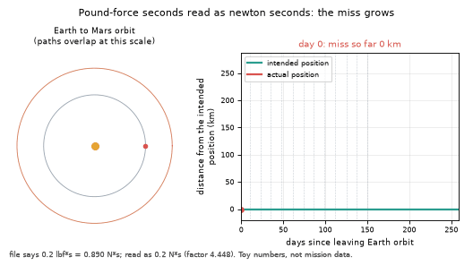
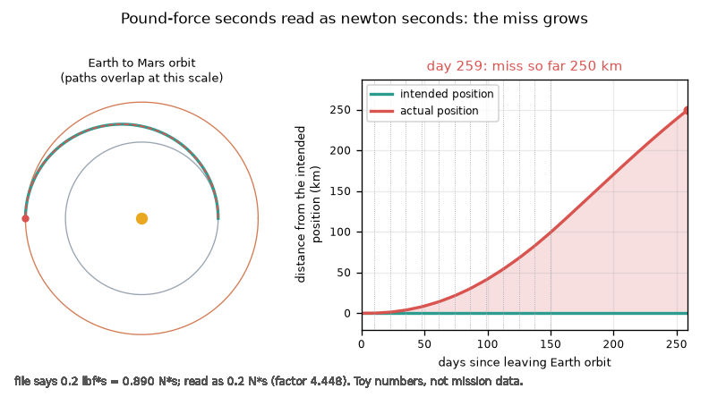
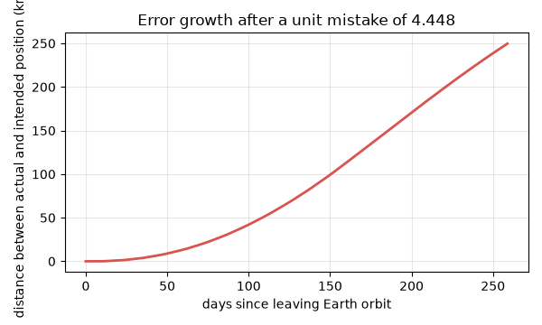

# What you are building toward

A toy spacecraft cruises from Earth's orbit towards Mars's orbit under the Sun's gravity and makes twelve small thruster firings. The ground file lists each firing as 0.2 lbf*s, which is really 0.890 N*s. In the animation the software reads the number as 0.2 N*s. On the left the two paths look identical on the map of the orbits; on the right the actual position peels away from the intended one and the miss grows to about 250 km by day 259. The numbers are illustrative, not mission data. Your goal over the coming sessions: build this comparison yourself, with a real orbit under gravity, and a unit checker that stops the mistake at the door.

*Target: a unit mistake of 4.448 grows into a miss on a toy Earth-to-Mars cruise*

*Target at the end of the cruise: miss about 250 km (toy numbers)*

*Distance between actual and intended position against time*

These results come from a private reference build. The code is not published; the roadmap shows the path so you can build your own.

Live links:

- [Math Visual Studio: numbers, quantities, units and dimensions (Atlas S01)](https://krunalpanchal1995.github.io/studio/#atlas?ch=S01&ex=1)
- [Math Visual Studio: more worked examples on units (Atlas S01, example 3)](https://krunalpanchal1995.github.io/studio/#atlas?ch=S01&ex=3)
