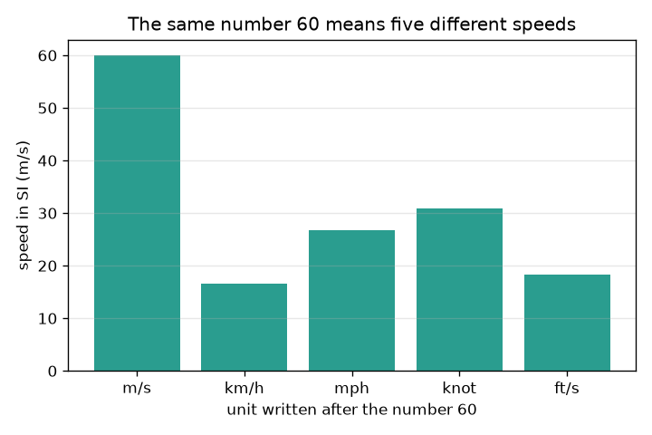
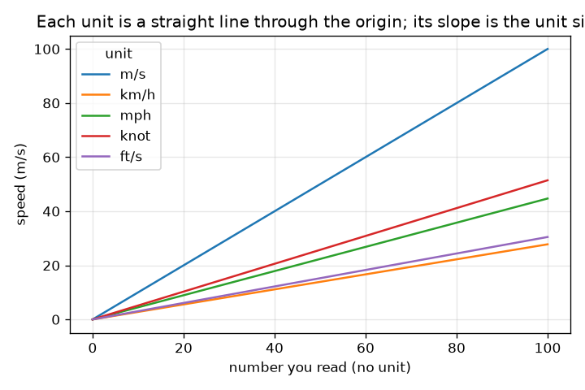

# Session 1: A number without a unit is not an answer

*Level 1 (conceptual interactive model) · about 60 minutes · openunits*

> This is a simplified educational model. It is not a validated design tool and must not be used for real structures, electrical installations, vehicles, industrial processes or medical decisions.

**Prerequisites**

- Multiplying and dividing decimals; powers of ten.
- You have read PRIMER.md and run `python start.py 1` once.

**Learning objectives.** After this session you can:

- Explain why a number needs its unit to be an answer.
- Convert between units of length and speed using the size of each unit in SI.
- Use SI prefixes (kilo, milli, micro and others) as powers of ten.
- Round to a sensible number of significant figures and read a graph of unit conversion lines.

## A. Real-world problem
A friend texts 'the car did 60'. Sixty what? Metres per second is a fast sprinter, kilometres per hour is a slow city drive, miles per hour is a little faster than that. Mixing units is not just a school mistake: it has cost real engineering projects dearly. Can we build a converter that never forgets the unit, and see how much a missing unit can change a number?

## B. Concept and theory
SI (the international system of units) uses the metre (m) for length, the kilogram (kg) for mass and the second (s) for time. Every other unit is a fixed multiple of an SI unit: 1 km = 1000 m, 1 ft = 0.3048 m and 1 mile = 1609.344 m exactly. To convert, change to SI and then to the target unit: the number in the new unit is the old number times (size of old unit) divided by (size of new unit). A prefix is a power of ten written in front of a unit: kilo = 10^3, milli = 10^-3, micro = 10^-6. Significant figures say how many digits of a number you can trust: a result should not claim more digits than the input data.

| Symbol | Meaning | Unit |
|---|---|---|
| n | the number written before the unit | no unit |
| F_u | size of unit u in SI | SI units per unit |
| v | a speed | m/s |
| k | power of ten of a prefix | no unit |

**Assumptions**

- Exact definitions are used for feet, miles and knots (nautical mile 1852 m).
- Only conversions between units of the same kind are allowed (length to length, speed to speed).
- Rounding happens at the end, not in the middle of a calculation.

$$ n_{\text{new}}=n_{\text{old}}\,\frac{F_{\text{old}}}{F_{\text{new}}} $$

$$ 1\ \text{km/h}=\frac{1000\ \text{m}}{3600\ \text{s}}=0.2778\ \text{m/s} $$

$$ \text{kilo}=10^{3},\qquad \text{milli}=10^{-3},\qquad \text{micro}=10^{-6} $$

## C. Visual explanation
The first figure shows the bare number 60 written with five different units, drawn as the speed it really means in m/s: from 16.7 m/s (km/h) to 60 m/s (m/s). The second figure plots speed in m/s against the number you read, for each unit. Each unit is a straight line through zero and its slope is the size of the unit, so a steeper line is a bigger unit.

*The number 60 with five different units means five different speeds.*

*Each unit is a straight line through zero; its slope is the unit size in m/s.*

## D. Interactive simulation
Run the lesson (`python start.py 1`), then open the live app: [Session 1: a speed converter](https://krunalpanchal1995.github.io/openunits/session-01/) (or `app.html` in this folder). Choose a number and a unit code (1 m/s, 2 km/h, 3 mph, 4 knot, 5 ft/s). Watch the bars in the picture view and the lines in the graph view; the readout shows the same speed in three units.

**Challenge.** Find the setting that means 27.8 m/s with the unit km/h.

## E. Worked example and experiment
**Problem.** A sign says 72 km/h. Find the speed in m/s. Then convert 60 mph to km/h and give the answer to 3 significant figures.

1. 1 km/h = 1000 m / 3600 s = 0.27778 m/s.
2. 72 km/h = 72 * 0.27778 = 20.0 m/s.
3. 1 mph = 1609.344 m / 3600 s = 0.44704 m/s, and 1 km/h = 0.27778 m/s.
4. 60 mph = 60 * 0.44704 / 0.27778 = 96.56 km/h.
5. To 3 significant figures: 96.6 km/h.

**Answer.** 72 km/h is exactly 20 m/s, and 60 mph is 96.6 km/h (3 significant figures).

**Experiment.** Mark out 10.0 m with a tape measure, walk it at a steady pace and time it with a phone stopwatch. Compute your speed in m/s, then convert to km/h by multiplying by 3.6. A typical walking pace is a few km/h; compare with your phone's step-counting app. Any difference comes from reaction time at the start and stop (about 0.2 s of error on a 7 s walk is 3 percent): the conversion is exact, the measurement is not.

## F. Assessment and design challenge
**Question type A: Conceptual.** Why is '60' not a complete answer to 'how fast was the car?' What must you add, and why does the SI unit help when two people disagree?

Hint

Think about what 60 means with km/h, mph and m/s.

Step-by-step solution

The number alone does not say which unit it counts in; 60 can mean 16.7 m/s, 26.8 m/s or 60 m/s. An answer is a number together with its unit. Converting both to SI (m/s) puts the two statements on the same scale so they can be compared.

**Question type B: Numerical.** Convert 100 km/h to m/s and to mph. Check that your answers are sensible.

Hint

Use 1 km/h = 0.27778 m/s and 1 mph = 0.44704 m/s.

Step-by-step solution

100 km/h = 100 / 3.6 = 27.78 m/s. In mph: 27.78 / 0.44704 = 62.14 mph. Sanity check: a mile is longer than a kilometre, so the mph number must be smaller than the km/h number: 62 is smaller than 100. Good.

**Question type C: Graph and simulation interpretation.** In the graph of speed against the number read, which unit gives the highest speed for the number 60, and which the lowest? What does the slope of each line mean?

Hint

Compare the heights of the lines at 60 on the x axis.

Step-by-step solution

At 60, m/s gives 60 m/s (highest), mph 26.8 m/s, knot 30.9 m/s, ft/s 18.3 m/s and km/h 16.7 m/s (lowest). The slope is the size of one unit in m/s, so m/s has slope 1 and km/h slope 0.278.

**Question type D: Design and optimisation challenge.** Design: a road sign for visitors must show a 50 km/h limit and a mph equivalent. Choose a rounding and justify it, noting the trade-off between clarity and accuracy.

Hint

Convert 50 km/h to mph and compare rounding up with rounding down.

Step-by-step solution

50 km/h = 50 * 1000 / 1609.344 = 31.07 mph. Rounding down to 30 mph is easy to read but would let a driver who follows the mph number go 1.07 mph (3.5 percent) too slow, which is safe; rounding up to 31 or 32 invites speeding slightly over the metric limit. A sensible design shows 31 mph (nearest whole number) or states 'about 30 mph' with the legal number in km/h. Assumption: whole numbers are easier to read than decimals.

Score yourself with [RUBRIC.md](../../RUBRIC.md). Print the [activity sheet](activity_sheet.md) to work on paper.

## Common misconceptions
| Common misconception | What is actually true |
|---|---|
| The number is the answer; the unit is decoration. | The unit is part of the answer. 60 m/s and 60 km/h differ by a factor of 3.6. |
| Prefixes change the size only a little. | A prefix is a power of ten: 1 km is 1000 m and 1 mm is 0.001 m, so a kilometre is a million millimetres. |
| More digits means a better answer. | Extra digits claim precision you do not have. A result cannot be more precise than the data that went into it. |

## Glossary
- **SI**: the international system of units, built on the metre, kilogram and second
- **prefix**: a letter in front of a unit that means a power of ten (k = 1000, m = 0.001)
- **conversion factor**: the number of SI units in one of another unit, such as 0.3048 m in one foot
- **significant figures**: the digits of a number that you can trust

## Finish
1. Do the three coding tasks in [exercises.md](exercises.md).
2. Run `python start.py 1` again after your changes. It ends with the checkpoint; when it prints `PASS`, you are done. (Checkpoint only: `python start.py check 1`.)

Next: [Session 2](../session-02/README.md)
