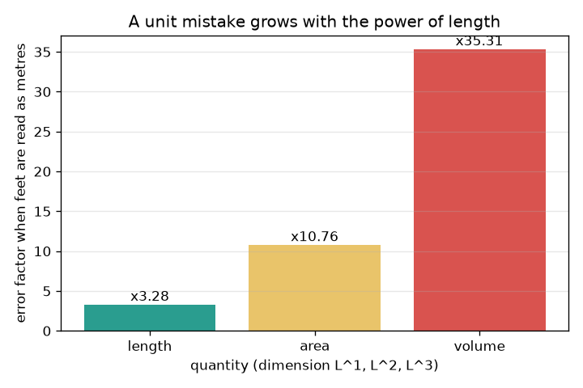
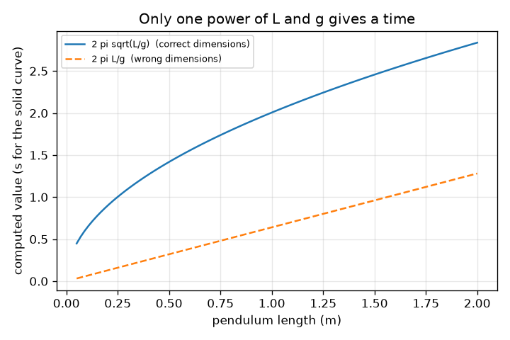

# Session 2: Dimensional analysis and the growth of unit errors

*Level 2 (mathematical engineering model) · about 75 minutes · openunits*

> This is a simplified educational model. It is not a validated design tool and must not be used for real structures, electrical installations, vehicles, industrial processes or medical decisions.

**Prerequisites**

- Session 1: units and conversion.
- Powers and exponents (adding exponents when multiplying).

**Learning objectives.** After this session you can:

- Write the dimension of a quantity as an exponent vector of mass, length and time.
- Check an equation dimensionally and say what the check can and cannot prove.
- Use dimensions to find how a quantity depends on others (solve for exponents).
- Compute how a hidden unit mistake grows with the powers in a formula.

## A. Real-world problem
An engineer writes s = u t + a t. A student feeds a pipe length in feet into a formula built for metres. Neither mistake is caught by the computer, because a computer only sees numbers. Can we check a formula by looking only at the kinds of quantity in it, and can we say how bad a unit mistake will be before it happens?

## B. Concept and theory
Every physical quantity has a dimension: a combination of the base dimensions mass (M), length (L) and time (T). Write it as an exponent vector [M, L, T]. A speed is length over time, [0, 1, -1]; a force is mass times acceleration, [1, 1, -2]. Multiplying quantities adds their vectors; dividing subtracts; raising to a power multiplies. An equation is dimensionally consistent only if every term that is added has the same vector as the left side. If the dimensions fail to match, the equation is certainly wrong; if they match, it may still be wrong (for example a missing factor of 1/2). If a quantity depends on others through a product of powers, matching the exponents gives linear equations for the powers. Finally, if a length unit is wrong by a factor f, a quantity of dimension L^b is wrong by f^b.

| Symbol | Meaning | Unit |
|---|---|---|
| M, L, T | base dimensions: mass, length, time | exponents (no unit) |
| d | dimension vector [M, L, T] | exponents |
| f | factor by which a length is mis-scaled | no unit |
| g | gravitational acceleration (9.80665) | m/s^2 |
| e_i | relative error of input i | no unit |

**Assumptions**

- Only three base dimensions are used; temperature and electricity are left out.
- Dimensional analysis cannot find pure numbers such as 2 pi.
- Errors in different inputs are independent when combined by root sum of squares.

$$ [\text{force}]=\mathsf{M}\,\mathsf{L}\,\mathsf{T}^{-2},\qquad [\text{impulse}]=[\text{force}][\text{time}]=\mathsf{M}\,\mathsf{L}\,\mathsf{T}^{-1} $$

$$ T\propto L^{p}g^{q}m^{r}:\quad r=0,\ \ p+q=0,\ \ -2q=1\ \Rightarrow\ T\propto\sqrt{L/g} $$

$$ \text{error factor}=f^{\,b}\ \text{for a quantity of dimension }\mathsf{L}^{b} $$

$$ \frac{\delta Q}{Q}\approx\sqrt{\sum_i\left(n_i\,e_i\right)^2}\ \text{ for }Q=\prod_i x_i^{n_i} $$

## C. Visual explanation
The first figure shows how large a 'feet read as metres' mistake gets for a length, an area and a volume: x3.28, x10.76 and x35.31, because each is the length factor raised to the power in its dimension. The second plots two candidate formulas for a pendulum: 2 pi sqrt(L/g) has the dimension of time, while 2 pi L/g has the dimension of time squared, so its curve is not a period at all.

*Feet read as metres: the error grows with the power of length in the dimension.*

*Only one power of L and g gives a time: 2 pi sqrt(L/g) versus the wrong 2 pi L/g.*

## D. Interactive simulation
Run the lesson (`python start.py 2`), then open the live app: [Session 2: which formula has the dimension of time?](https://krunalpanchal1995.github.io/openunits/session-02/) (or `app.html` in this folder). Set the exponents p and q of the candidate formula 2 pi L^p g^q. In the dimension view see whether the T bar matches the outlined target; in the graph view compare your curve with the true period.

**Challenge.** Find the exponents p and q for which the formula has the dimension of time.

## E. Worked example and experiment
**Problem.** Use dimensions to find how the period T of a pendulum depends on its length L, on g and on its mass m, then compute the period for L = 1.000 m.

1. Assume T ~ L^p g^q m^r. Dimensions: L is [0, 1, 0], g is [0, 1, -2], m is [1, 0, 0], T is [0, 0, 1].
2. Mass exponent: r = 0, so the mass does not matter.
3. Length exponent: p + q = 0. Time exponent: -2q = 1, so q = -0.5 and p = 0.5.
4. So T = (constant) * sqrt(L/g). The constant is not fixed by dimensions; physics gives 2 pi for small swings.
5. For L = 1.000 m and g = 9.80665 m/s^2: T = 2 pi sqrt(1/9.80665) = 2.006 s.

**Answer.** T goes as L^0.5 g^-0.5 and is independent of mass; a 1.000 m pendulum swings in 2.006 s.

**Experiment.** Hang a small weight on a 1.000 m string, swing it through a small angle (about 10 degrees) and time 20 swings with a phone stopwatch: expect about 40.1 s, so 2.006 s per swing. Differences come from a swing angle that is not small, the string and weight not being a point mass, the pivot not being at a single point, and reaction time. Local g also differs slightly from 9.80665 m/s^2.

## F. Assessment and design challenge
**Question type A: Conceptual.** A formula passes the dimension check. Does that prove it is correct? Give an example and say what a failing check proves.

Hint

Compare s = u t + a t^2 with the correct version.

Step-by-step solution

No. s = u t + a t^2 has all terms with the dimension of length, so it passes, but the correct formula has a factor 1/2 in front of the last term. Dimension checks cannot see pure numbers. A failing check does prove the formula is wrong: s = u t + a t adds a length to a speed.

**Question type B: Numerical.** A tank volume of 12.0 'cubic metres' was really 12.0 cubic feet. By what factor is the volume overstated, and what is the true volume in litres?

Hint

Volume has dimension L^3; one foot is 0.3048 m.

Step-by-step solution

The overstatement factor is (1 / 0.3048)^3 = 35.31. True volume = 12.0 * 0.3048^3 m^3 = 12.0 * 0.028317 = 0.340 m^3 = 340 litres. Sanity check: a cubic foot is a bit more than 28 litres, and 12 of them are about 340 litres.

**Question type C: Graph and simulation interpretation.** In the app with p = 1 and q = -1, what dimension does the formula 2 pi L^p g^q have, and why is the curve far from the grey period curve?

Hint

Read the readout: the exponent of T is -2q.

Step-by-step solution

The dimension is [0, 0, 2], that is time squared. The value 2 pi L/g at L = 1 m is 0.641 and carries the unit s^2, so it cannot be compared with a period in seconds. The dimension view shows the T bar at 2 instead of 1.

**Question type D: Design and optimisation challenge.** Design: a mass m on a spring of stiffness k (force per length) oscillates with period T. Use dimensions to find how T depends on m and k, then say what dimensional analysis cannot tell you.

Hint

k has dimension force/length = [1, 0, -2]. Try T ~ m^p k^q.

Step-by-step solution

Mass exponent: p + q = 0. Time exponent: -2q = 1, so q = -1/2 and p = 1/2, T ~ sqrt(m/k). Length does not appear. Dimensional analysis cannot give the pure number 2 pi, nor tell whether other variables (such as amplitude) matter. Experiment or a real derivation must supply those. Trade-off: speed and generality against exactness.

Score yourself with [RUBRIC.md](../../RUBRIC.md). Print the [activity sheet](activity_sheet.md) to work on paper.

## Common misconceptions
| Common misconception | What is actually true |
|---|---|
| If the units match, the formula is right. | Matching dimensions is necessary, not sufficient. Pure numbers such as 1/2 or 2 pi are invisible to the check. |
| A unit mistake of a factor 3 gives an answer wrong by a factor 3. | The mistake is raised to the power of the dimension: a volume is wrong by 3^3 = 27. |
| Mass matters for a pendulum's period. | The dimension argument shows no mass-dependence is possible, because nothing else in the problem can cancel the mass dimension. |

## Glossary
- **dimension**: the kind of quantity: mass, length, time or a combination
- **exponent vector**: the list [M, L, T] of powers that describes a dimension
- **dimensionless**: a quantity with all exponents zero, such as a ratio
- **dimensional analysis**: using dimensions to check or find formulas
- **relative error**: an error divided by the true value

## Finish
1. Do the three coding tasks in [exercises.md](exercises.md).
2. Run `python start.py 2` again after your changes. It ends with the checkpoint; when it prints `PASS`, you are done. (Checkpoint only: `python start.py check 2`.)

Next: [Session 3](../session-03/README.md)
