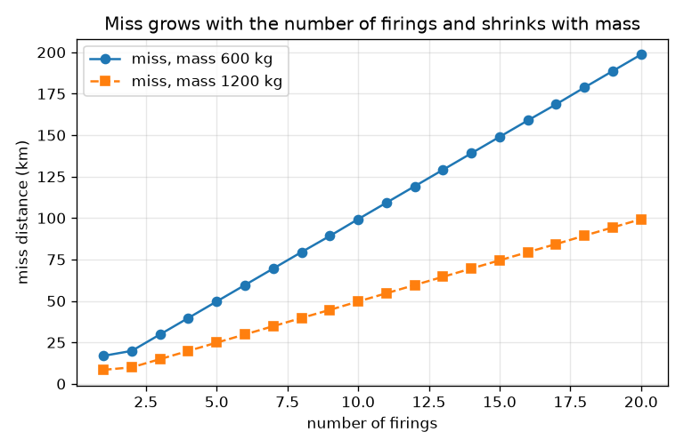
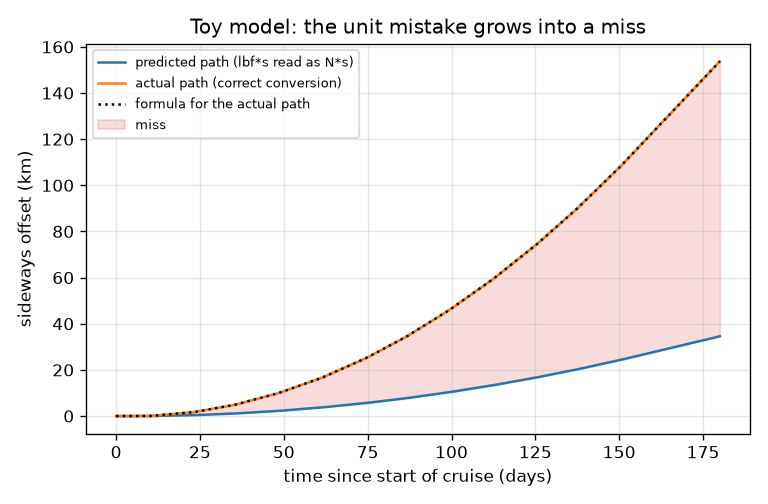

# Session 3: A toy trajectory and a units-checked wrapper

*Level 3 (simulation and validation) · about 90 minutes · openunits*

> This is a simplified educational model. It is not a validated design tool and must not be used for real structures, electrical installations, vehicles, industrial processes or medical decisions.

**Prerequisites**

- Session 1: converting units.
- Session 2: dimension vectors and error factors.

**Learning objectives.** After this session you can:

- Explain, with well-established facts, how a lbf*s versus N*s mismatch affected the Mars Climate Orbiter.
- Simulate a toy trajectory correction and compute the miss distance caused by a unit factor of 4.448222.
- Validate the simulation against a closed-form formula and test its sensitivity to mass, impulse and number of firings.
- Write and use a numpy-only units-checked wrapper, and say exactly which errors it catches and which it cannot.

## A. Real-world problem
In 1999 NASA's Mars Climate Orbiter was lost at Mars. The investigation found that ground software produced thruster impulse data in pound-force seconds while the navigation software expected newton seconds. One pound-force second is about 4.45 newton seconds, so the small thruster firings were misjudged by that factor, and the spacecraft approached Mars lower than planned. Could a few lines of code have caught this? This session builds a toy model, not the real mission: its numbers (mass, firings, cruise time) are illustrative and no real mission data are used.

## B. Concept and theory
A thruster firing gives the spacecraft an impulse J (newton seconds). The velocity change is dv = J / m. A sideways kick at time t_k then makes the spacecraft drift sideways by dv * (t - t_k) after time t, so with several firings the offset is the sum over firings. Suppose the file lists numbers in lbf*s. The right conversion multiplies the number by 4.448222 to get N*s. If software reads the number as N*s (factor 1) it predicts a push that is 4.448222 times too small, and the actual path drifts away from the predicted one. The miss at the end is therefore (f_true - f_used) / m times the sum of J * (T - t_k). A units-checked wrapper stores values in SI together with a dimension vector; it refuses to add quantities of different dimensions and refuses bare numbers at a boundary. Note that lbf*s and N*s have the same dimension, so only the attached unit and its automatic conversion prevent the mistake, not the dimension check alone.

| Symbol | Meaning | Unit |
|---|---|---|
| J | impulse number in the file for one firing | lbf*s |
| f | newton seconds per file unit (4.448222 true, 1 for the bug) | N*s per lbf*s |
| m | spacecraft mass (toy value 600) | kg |
| dv | velocity change per firing | m/s |
| t_k, T | time of firing k and end of cruise | s |
| n | number of firings | no unit |

**Assumptions**

- Toy model: straight-line sideways drift with no gravity and no thruster direction errors.
- Mass is constant and all firings have equal impulse.
- Spacecraft numbers are illustrative, not mission data; the real navigation problem is far more complex.

$$ \Delta v=\frac{J\,f}{m} $$

$$ y(t)=\sum_{k}\Delta v\,(t-t_k)\quad (t\ge t_k) $$

$$ \text{miss}=\frac{n\,J\,(f_{\text{true}}-f_{\text{used}})}{m}\,\bigl(T-\overline{t_k}\bigr),\qquad f_{\text{true}}=4.448222 $$

## C. Visual explanation
The first figure shows two sideways paths over the 180-day toy cruise: the predicted one (lbf*s read as N*s) and the actual one. The shaded gap between them is the miss; it starts at zero, grows with each firing and ends at 119.17 km. The dotted line is the closed-form formula and lies on top of the simulated actual path. The second figure shows the miss against the number of firings for two spacecraft masses: it is a straight line in n, and doubling the mass halves it.

*Miss against number of firings for 600 kg and 1200 kg spacecraft.*

*Toy model: predicted and actual sideways offset; the shaded gap is the miss (119.17 km).*

## D. Interactive simulation
Run the lesson (`python start.py 3`), then open the live app: [Session 3: a unit mistake grows into a miss](https://krunalpanchal1995.github.io/openunits/session-03/) (or `app.html` in this folder). Change the file number per firing, the number of firings and the conversion factor used by the software. Compare the predicted and actual paths, then the arrival board and the miss-versus-firings graph.

**Challenge.** Fire at least 10 times with at least 0.5 lbf*s each and still keep the miss below 5 km, by choosing the conversion factor.

## E. Worked example and experiment
**Problem.** A 600 kg toy spacecraft makes 12 firings of 0.2 lbf*s on days 10, 23, 35, ... 150 (mean day 80). The software reads the numbers as N*s. Find the miss distance at day 180 by hand and compare with the simulation.

1. Mean firing day is 80, so the average drift time is 180 - 80 = 100 days = 8.64 million s.
2. Per firing the true dv is 0.2 * 4.448222 / 600 = 0.0014827 m/s; the predicted dv is 0.2 / 600 = 0.0003333 m/s.
3. Difference per firing: 0.0011494 m/s. For 12 firings: 0.013793 m/s.
4. Miss = 0.013793 m/s * 8.64 million s = 119 170 m = 119.17 km.
5. The simulation gives the same 119.17 km, and the actual path is 4.4482 times the predicted one (153.73 km against 34.56 km).

**Answer.** Miss of about 119.2 km in the toy model: the real sideways offset is 153.7 km, the predicted one 34.6 km.

**Experiment.** Roll a small ball along a table and, after one second, give it a sideways flick with a ruler. Compare where it ends up with a ball flicked 4.45 times less hard. The model says the sideways offset is proportional to the flick size times the time left, so the offsets differ by 4.45. In reality friction and an uneven table change the numbers. A real spacecraft adds gravity, the direction of each firing and tracking data, which this toy leaves out.

## Real-world application and mini-project: Audit a short engineering calculation for unit errors
A colleague hands you this four-line calculation for a small thruster test: (1) F = 25 lbf, t = 12 s. (2) Impulse I = F * t = 300. (3) Velocity change dv = I / m with m = 40 kg, so dv = 7.5 m/s. (4) Distance after 1 hour: d = dv * 1 = 7.5 km. Rewrite it with the `Quantity` class from Session 3, find every unit error, and report the corrected numbers. The colleague also proposes adding a 30 N force to the impulse in a later line: show that the wrapper refuses it.

**Deliverable:** A script that prints, for each of the four lines, whether it is correct, and the corrected impulse (N*s), dv (m/s) and distance (km), plus a one-paragraph audit note in plain English.

**Success looks like:** Corrected impulse 1334.5 N*s, dv 33.4 m/s and distance 120.1 km (within 0.1 of each), the force plus impulse line raises DimensionError, and the note names which errors a dimension check can catch and which it cannot.

## F. Assessment and design challenge
**Question type A: Conceptual.** Why does a dimension check not catch a lbf*s number read as N*s? What kind of design would catch it?

Hint

Compare the dimension vectors of lbf*s and N*s.

Step-by-step solution

Both are force times time, [1, 1, -1], so the dimension check sees no difference; only their size differs (4.448222). A design that attaches the unit to every number (Quantity objects), converts at the boundary and refuses bare numbers would catch it, as would a file format with an explicit unit field.

**Question type B: Numerical.** Eight firings of 0.5 lbf*s each (on days 10, 30, ... 150) are read as N*s on a 600 kg craft. What is the miss at day 180?

Hint

Use the closed form: n J (f_true - 1) / m times (T - mean firing day).

Step-by-step solution

Mean firing day = 80, so T - mean = 100 days = 8.64e6 s. n J = 4 lbf*s in total. Miss = 4 * 3.448222 / 600 * 8.64e6 = 198 617 m = 198.6 km. Sanity check: it is the same as 20 firings of 0.2 lbf*s, because only n J matters.

**Question type C: Graph and simulation interpretation.** In the miss-versus-firings graph, what is the shape of the curve and what does doubling the spacecraft mass do to it?

Hint

Look at the formula: miss is proportional to n and to 1/m (the firing dates also change slightly with n).

Step-by-step solution

The curve is nearly a straight line rising with n (the firing dates move a little as n changes, because they are spread from day 10 to day 150). With mass 1200 kg instead of 600 kg the whole curve is halved: 59.6 km instead of 119.2 km at n = 12, because dv = J f / m.

**Question type D: Design and optimisation challenge.** Design: with 12 firings of 0.2 lbf*s on a 600 kg craft the miss must stay below 5 km. How wrong may the software's conversion factor be? Propose two checks that would have prevented the bug.

Hint

Miss is proportional to |4.448222 - f_used|; the case f = 1 gives 119.17 km.

Step-by-step solution

Miss per unit of factor error is 119.17 / 3.448222 = 34.56 km. So |4.448222 - f| must be below 5 / 34.56 = 0.145: any factor between about 4.30 and 4.59 passes (4.45 gives 0.06 km, 4.4 gives 1.7 km, 4.3 gives 5.1 km). Checks: (1) every file carries a unit field and the reader refuses a file without one; (2) a unit-aware calculation (Quantity) converts to SI at the boundary. A third: an independent end-to-end test with a known thrust.

Score yourself with [RUBRIC.md](../../RUBRIC.md). Print the [activity sheet](activity_sheet.md) to work on paper.

## Common misconceptions
| Common misconception | What is actually true |
|---|---|
| A dimension check would have caught the Mars Climate Orbiter bug. | Both units are impulse, so the dimensions match. What was missing was an explicit, enforced unit on the data passed between systems. |
| The model shows what happened to the real spacecraft. | It is a toy model with illustrative numbers. It shows how a factor of 4.45 scales into a miss, not the real trajectory. |
| A small factor error gives a small miss. | The miss grows with the time left after each firing: an error made early has the longest time to grow. |

## Glossary
- **impulse**: force times the time it acts; unit N*s; equal to the change of momentum
- **lbf*s**: pound-force second, about 4.448222 N*s
- **Quantity**: a value stored in SI together with its dimension vector
- **miss distance**: the gap between where the spacecraft is and where it was predicted to be
- **boundary**: the place where data pass from one program or team to another

## Finish
1. Do the three coding tasks in [exercises.md](exercises.md).
2. Run `python start.py 3` again after your changes. It ends with the checkpoint; when it prints `PASS`, you are done. (Checkpoint only: `python start.py check 3`.)

Next: the [roadmap](../../promo/roadmap.md). Session 4 is yours to build.
